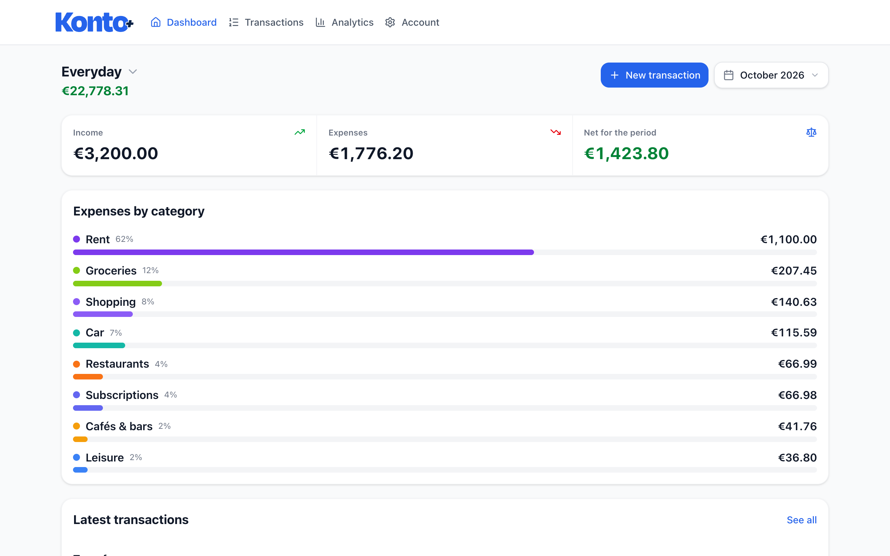
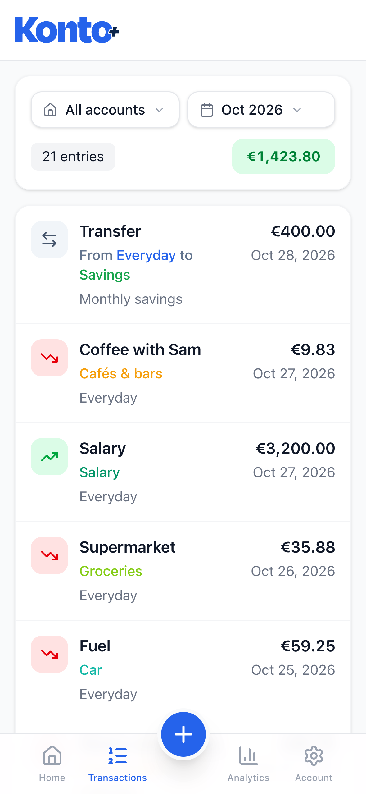
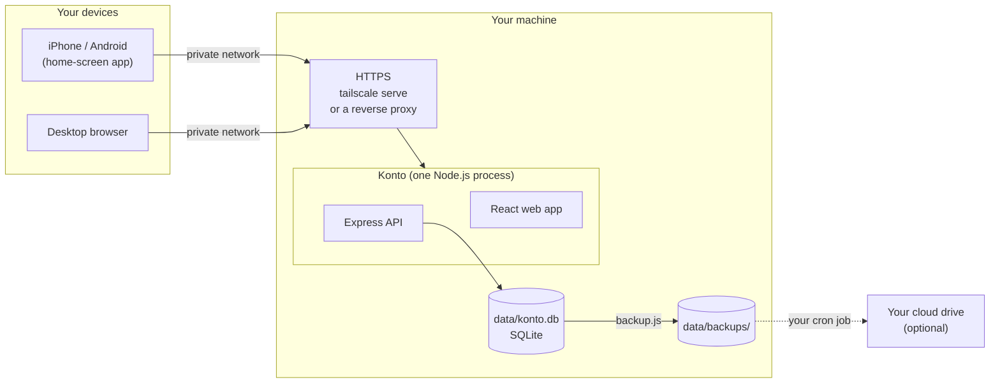
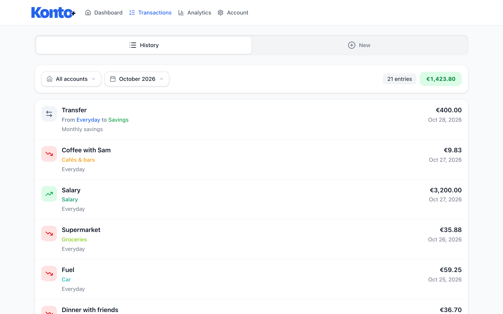
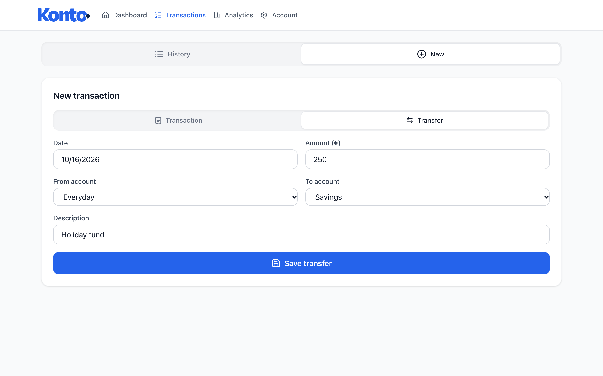
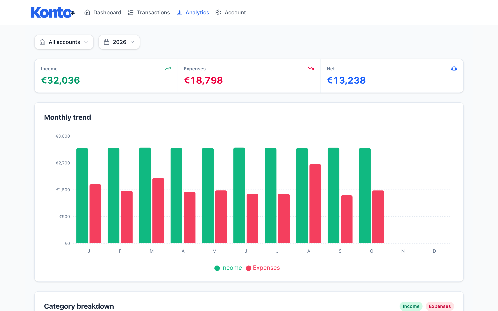
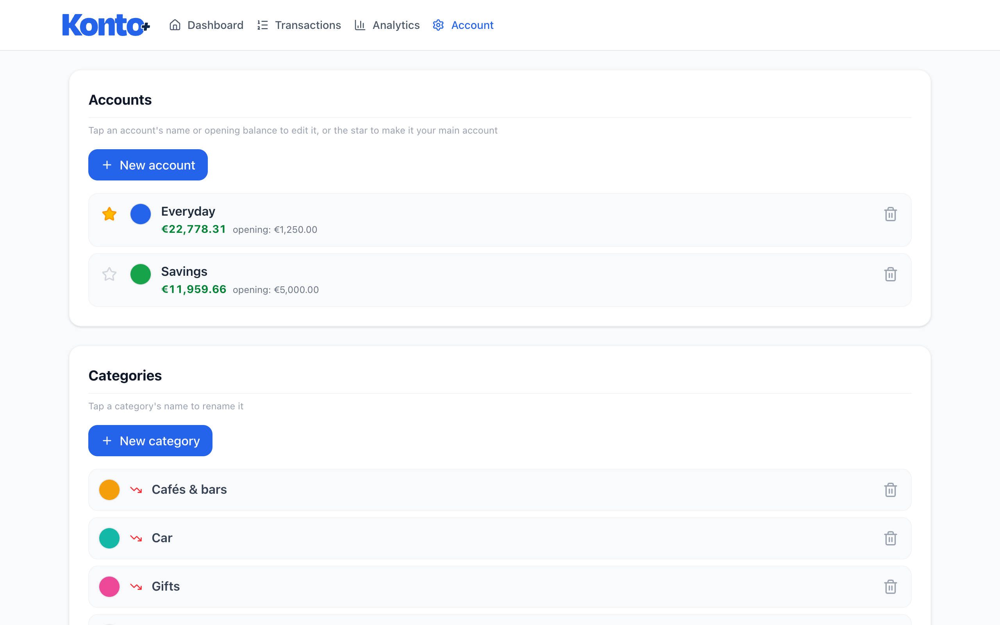
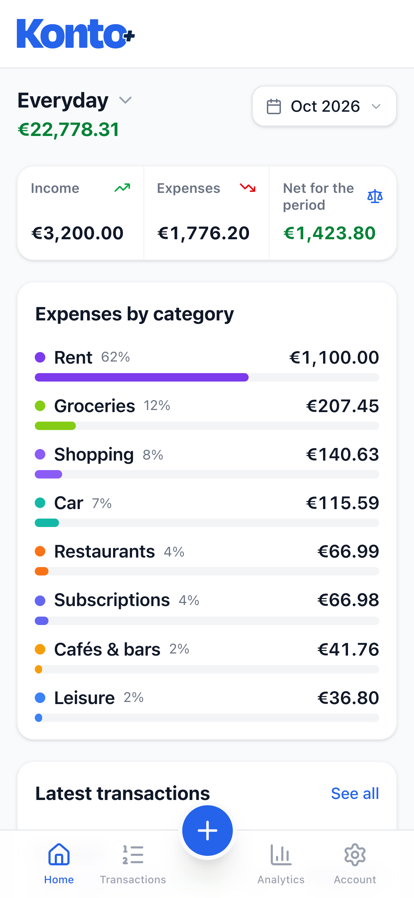
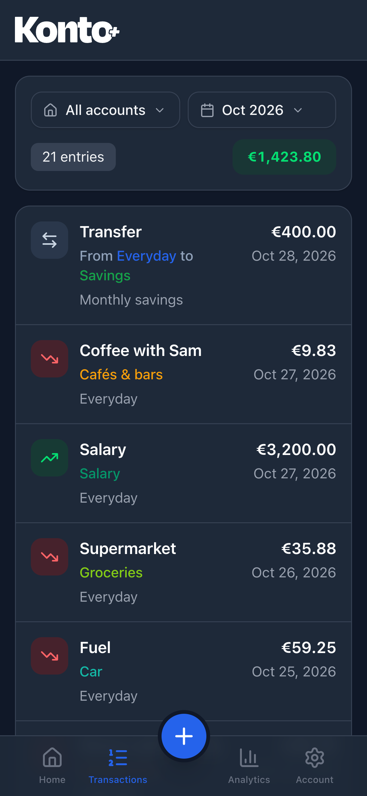
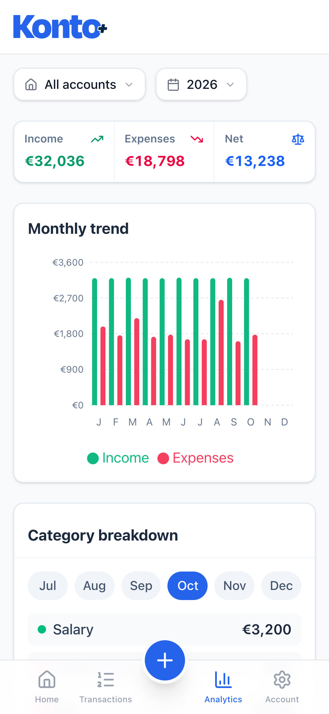

<div align="center">

<picture>
  <source media="(prefers-color-scheme: dark)" srcset="frontend/public/logo-white.svg" />
  
</picture>

**A self-hosted, mobile-first expense tracker for you and a few trusted people.**

[](https://github.com/susinoo/Konto/actions/workflows/ci.yml)
[](LICENSE)


[Quick start](#quick-start) · [How it works](#how-konto-works) · [Features](#features) · [Documentation](#documentation) · [FAQ](#faq) · [Contributing](#contributing)

</div>

> [!IMPORTANT]
> The official source of Konto is this repository. Copies, forks and images published elsewhere are not reviewed by the author.

Konto keeps track of where your money goes, across several accounts, in English or Italian. It runs on your own machine as a single small process with a SQLite file: no external database, no cloud service, no tracking. It is built to be used from a phone, on a private network such as [Tailscale](https://tailscale.com/), by you and the few people you trust.

<p align="center">
  <picture>
    <source media="(prefers-color-scheme: dark)" srcset="docs/screenshots/dashboard-desktop-dark.png" />
    
  </picture>
  &nbsp;
  <picture>
    <source media="(prefers-color-scheme: dark)" srcset="docs/screenshots/transactions-mobile-dark.png" />
    
  </picture>
</p>

<p align="center"><sub>Screenshots use the fictional demo data (<code>npm run seed:demo</code>).</sub></p>

## Quick start

With Docker and the Compose plugin:

```bash
git clone https://github.com/susinoo/Konto.git
cd Konto
cp backend/.env.example backend/.env   # set KONTO_USER, KONTO_PASS, SESSION_SECRET
mkdir -p data                          # database, sessions and backups
docker compose up -d --build
```

Konto now listens on `http://127.0.0.1:3000`, on the host only. Put HTTPS in front of it, for example with Tailscale:

```bash
tailscale serve --bg --https=8443 http://127.0.0.1:3000
```

and open `https://<machine>.<your-tailnet>.ts.net:8443` from any device on your tailnet. On a phone, add it to the home screen to use it as an app.

The manual install with Node.js and PM2, the other HTTPS options and every setting are in the [documentation](#documentation).

## How Konto works



- **One process, one file.** The Express server serves the built React app and the `/api` endpoints. All data lives in `data/konto.db`, with sessions in `sessions.db` next to it.
- **Private by design.** Konto is meant for a private network (Tailscale, WireGuard, a VPN) or a TLS reverse proxy you control. It is not designed as a public internet service ([security model](docs/security-model.md)).
- **Several users, isolated data.** Each user only ever sees their own accounts, categories and transactions. Sign-up is off by default.
- **Safe upgrades.** Schema changes are versioned migrations that run at startup, after a backup of the database.

The internals (data model, migrations, authentication, conventions) are described in [ARCHITECTURE.md](ARCHITECTURE.md).

## Features

| | |
| --- | --- |
|  | **Transactions.** Record income and expenses with your own categories, shared across your accounts. Tap a row to edit it. |
|  | **Transfers between accounts.** Move money from one account to another: balances follow, income, expenses and category totals are left untouched. |
|  | **Yearly analytics.** Monthly trend of income and expenses, and the breakdown by category month by month, across all accounts or for one. |
|  | **Accounts and categories.** Several accounts per user (personal, work, savings...), each with an opening balance and a live running balance. |

Also:

- **Mobile first**: designed for phones (iOS safe areas, large touch targets, a decimal keyboard for amounts) and installable as a home-screen app.
- **English and Italian** interface, with dates and amounts formatted for the language and a configurable currency. Adding a language is one JSON file.
- **Dark mode** that follows the system theme.
- **Your data stays yours**: CSV export for every user, a full database download for the instance owner, and consistent snapshots with [`backup.js`](docs/backups.md).
- **Self-service accounts**: change your password or delete your account and all its data.

<p align="center">
  
  &nbsp;
  
  &nbsp;
  
</p>

## Documentation

| Page | Contents |
| --- | --- |
| [Installation](docs/installation.md) | Docker (recommended) and manual install with PM2 |
| [HTTPS](docs/https.md) | `tailscale serve`, Tailscale sidecar container, certificate files |
| [Configuration](docs/configuration.md) | Every setting in `backend/.env` |
| [Backups](docs/backups.md) | Consistent snapshots, cron and cloud upload |
| [Upgrading](docs/upgrading.md) | Updates and the automatic migration from 1.x |
| [Maintenance scripts](docs/maintenance.md) | Password reset, owner flag, backups |
| [Security model](docs/security-model.md) | What Konto protects on its own and what is left to you |
| [ARCHITECTURE.md](ARCHITECTURE.md) | How the code works, for contributors |

## Development

Requirements: Node.js 22 or newer (see [`.nvmrc`](.nvmrc)).

```bash
cd backend && npm install && cp .env.example .env && npm run dev    # API on http://localhost:3000
```

```bash
cd frontend && npm install && npm run dev                            # Vite dev server, proxies /api
```

- **Demo data**: `npm run seed:demo` in `backend/` builds a database with two fictional users (`john.doe` and `jane.doe`, password `demo-password`), two accounts each and transactions from January 2025 to today. `npm run dev:demo` starts the backend on it. Use it for manual tests and screenshots, never real data.
- **Checks**: `npm test` in `backend/` (integration tests on a throwaway database), and `npm run lint`, `npm run i18n:check`, `npm run build` in `frontend/`. CI runs them all, plus a Docker build, on every pull request.
- **Testing from a phone**: the Vite dev server accepts LAN connections; for Tailscale hostnames set `VITE_TAILNET_HOST` in `frontend/.env` (see `frontend/.env.example`).
- **Working with an AI agent**: [AGENTS.md](AGENTS.md) lists the commands and the rules that are easy to break.

## FAQ

**Is Konto a hosted service?**
No. You run it yourself, on your own machine, and only the people you let into your private network can reach it.

**Can I use it on the public internet?**
It is not designed or tested for that. Keep it behind Tailscale, a VPN or a reverse proxy with TLS and access control, and keep sign-up disabled unless everyone who can reach the URL may create an account.

**Does it connect to my bank?**
No. Konto does not import from banks or other services: you record transactions yourself. Your data never leaves your machine unless you copy it elsewhere.

**Does it support several currencies?**
One currency per instance (`KONTO_CURRENCY`, EUR by default). Amounts are stored in cents, without a currency.

**How do I back up my data?**
Run `node backend/scripts/backup.js` (or `docker compose exec konto node backend/scripts/backup.js`) from cron and copy the snapshots to another machine. See [Backups](docs/backups.md).

**Can I add a language?**
Yes: copy `frontend/src/locales/en.json`, translate it and register it. See [CONTRIBUTING.md](CONTRIBUTING.md#adding-a-language).

## Contributing

Konto encourages a **fork-first** workflow: fork it, shape it to your needs, and tell us about it. Improvements that make sense for everyone are welcome as pull requests. See [CONTRIBUTING.md](CONTRIBUTING.md).

### Community forks

No forks listed yet. Built something on top of Konto? Open a [Show your fork](https://github.com/susinoo/Konto/issues/new?template=show-your-fork.yml) issue and it may be listed here.

## Security

Please report vulnerabilities privately, as described in [SECURITY.md](SECURITY.md). What Konto protects on its own, and what is left to whoever runs it, is in the [security model](docs/security-model.md).

## AI-assisted development

Konto was developed with the help of [Claude Code](https://claude.com/claude-code), Anthropic's AI coding assistant. The author drove the product and design decisions and tested the app in daily use.

AI-generated code can contain mistakes like any other code: issues and pull requests are welcome.

## Credits

- **Logo**: designed by [Affoghiamoci](https://github.com/Affoghiamoci) and licensed to the project under the MIT License.
- **Built on** [React](https://react.dev/), [Vite](https://vite.dev/), [Tailwind CSS](https://tailwindcss.com/), [Recharts](https://recharts.org/), [Lucide](https://lucide.dev/), [i18next](https://www.i18next.com/), [Express](https://expressjs.com/), [better-sqlite3](https://github.com/WiseLibs/better-sqlite3) and [SQLite](https://sqlite.org/), with every other package listed in [THIRD_PARTY_NOTICES.md](THIRD_PARTY_NOTICES.md).

## Trademarks

Node.js, React, Express, SQLite, Docker, Tailscale, GitHub, iPhone and iOS, and the other product names mentioned in this repository are trademarks or registered trademarks of their respective owners. Konto is an independent project and is not affiliated with, sponsored or endorsed by any of them.

## License

Konto is released under the [MIT License](LICENSE) © 2026 susinoo. It includes third-party open-source packages under their own licenses, listed in [THIRD_PARTY_NOTICES.md](THIRD_PARTY_NOTICES.md). Please also read the [disclaimer](DISCLAIMER.md).
